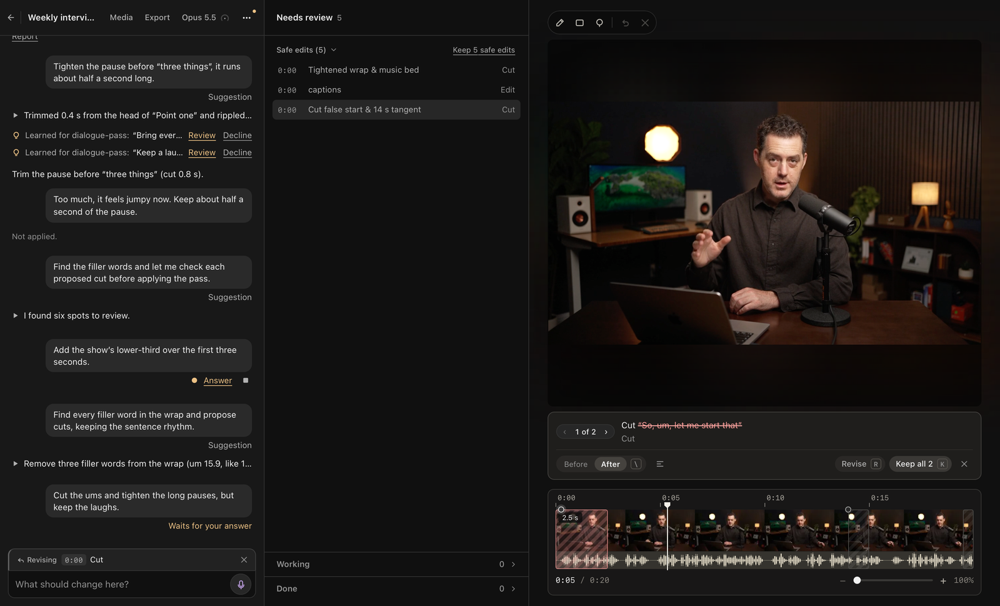
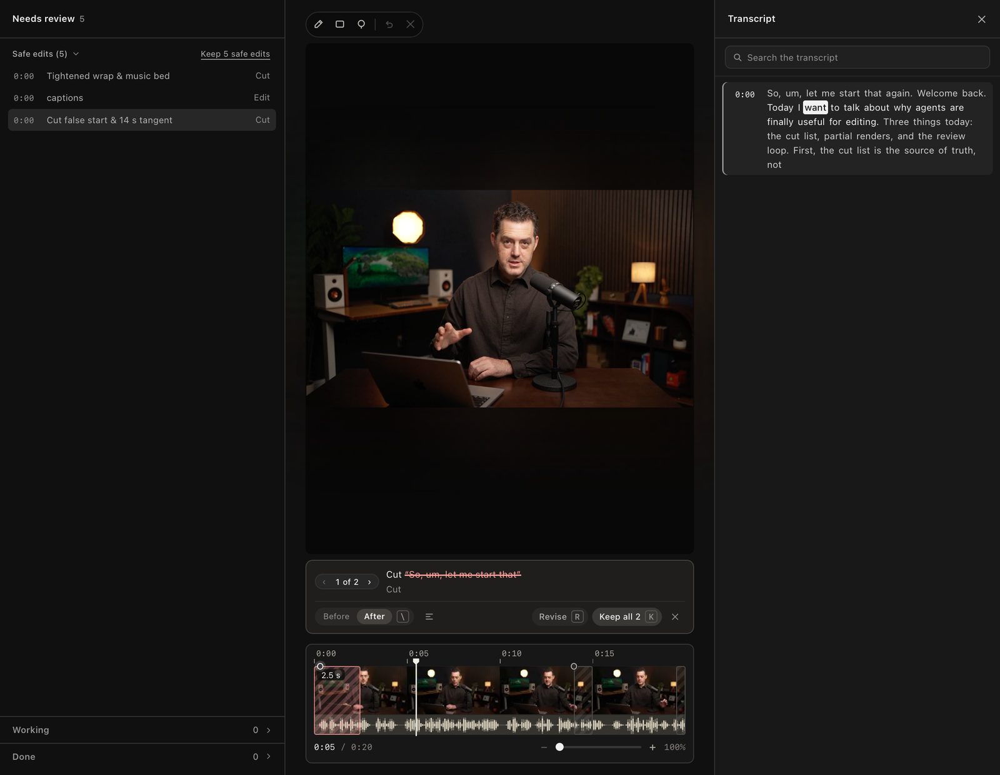

<p align="center">
  
</p>

<h1 align="center">Scarlet</h1>

<p align="center">
  <strong>The AI video editor that does the tedious part.</strong><br>
  Scarlet handles the ums, dead air, retakes and captions in seconds. You make the creative calls.
</p>

<p align="center">
  <a href="https://github.com/Forward-Future/scarlet/releases/latest"><strong>Download for macOS &amp; Windows</strong></a>
  &nbsp;·&nbsp;
  <a href="https://github.com/Forward-Future/scarlet-releases/releases?q=Ubuntu">Ubuntu 24.04 Preview</a>
  &nbsp;·&nbsp;
  <a href="https://github.com/Forward-Future/scarlet-releases/releases">Early Access</a>
  &nbsp;·&nbsp;
  <a href="skills/README.md">Editing Workflows</a>
</p>

<p align="center">
  
</p>

---

Most of editing isn't creative. It's scrubbing for the false start, nudging a pause, typing captions, cutting the same "um" for the fortieth time.

Scarlet hands that work to an AI agent. Say what you want, by voice or in writing. The edit lands on your timeline in seconds, and you hear it before you keep it. Your footage is never touched.

> “Tighten the pause before ‘three things.’ Let me hear it both ways.”

## Fast

- **Renders only what changed.** Scarlet re-renders the few seconds around an edit and reuses the rest, so playback stays instant on hour-long recordings.
- **Talk instead of scrub.** Hold `V` and say it. Pause on a frame, drag a range on the ruler, or select words in the transcript to point at the exact moment.
- **Draw on the frame (`M`).** Box, point or sketch on the picture so the agent sees what you mean. Drop in reference images or a brand guide PDF.
- **Several edits at once.** Send back different cuts for revision at the same time. Scarlet works on each in parallel and queues whole-video requests behind them.

## AI does the grunt work

- **Bring your own agent.** Connect **Claude Code**, **Codex** or **Gemini** with the subscription you already pay for, in **Settings → General**. Or use **Ollama**, **LM Studio** or **OpenRouter** models from **Settings → Models**. No extra AI bill.
- **Edits from measurements, not guesses.** Scarlet transcribes and aligns every word locally, reads text on screen, tracks faces and listens for room tone. The agent cuts between words, not through them.
- **Skills for the jobs you repeat.** Type `/` for a full first cut, captions, punch-ins, B-roll and more. Every skill is a Markdown file you can edit.
- **It learns your taste.** Say “keep the laughs, only cut the dead air after them” and Scarlet offers it as a rule for next time. Nothing changes until you approve it.

## You make the calls

<p align="center">
  
</p>

- **Safe edits stay out of your way.** Routine cuts are grouped under **Safe edits**. Keep them all in one click, or open any one to check it.
- **Judgment calls come to you.** Anything Scarlet isn't sure about waits in **Needs review**. Step through with `↑` / `↓` and press `K` to keep, `R` to revise or `X` to reject.
- **Before and After in one key.** Press `\` on any open edit to flip between the original and the new join. Open the cut's transcript to see the exact words that came out.
- **Nothing is final.** Every edit is a new version of the timeline. `⌘Z` / `Ctrl+Z` takes back a keep, a reject or a revision.

Prefer the old two-column view? Turn on **Classic workspace layout** in **Settings → General**.

## Skills

<p align="center">
  
</p>

| Skill | What it does |
| --- | --- |
| `/dialogue-pass` | First cut: false starts, repeated takes, filler words and dead air out, natural pacing kept, judgment calls flagged. |
| `/frame-screen` | Zooms screen recordings onto the active pane or the text being read, keeping camera insets clear. |
| `/punch-in` | Cuts between wide and tight framing on jump cuts and key lines, using local face tracking. |
| `/add-captions` | Clean, readable captions timed to the speech that's left. |
| `/motion-graphics` | Lower thirds, titles and callouts built in HTML/CSS/JS and rendered locally to transparent ProRes 4444. |
| `/b-roll` | Plans B-roll and graphic spots as to-dos, then sources or makes only the ones you pick. |
| `/split-edits` | J and L cuts so the next voice leads into its shot, or a line carries over the listener. |
| `/multi-cam` | Syncs cameras and mics, matches speakers to angles and switches shots at a natural pace. |
| `/color-match` | Evens out exposure, white balance and contrast across cameras, or applies your saved look. |
| `/speed-through-waits` | Speeds through installs, builds and loading screens, keeping speech at normal speed. |
| `/music-under-speech` | Dips music under every word and brings it back up in the gaps. |
| `/fit-length` | Trims to a target runtime, least essential parts first. |
| `/tighten-pauses-here` | Tightens pauses in a selected passage or around the playhead. |

Write your own in **Settings → Tools & skills**, or turn an edit you liked into one. [Browse all skills →](skills/README.md)

## Export

<p align="center">
  
</p>

- **MP4** of the whole cut or a range, in Compressed, High (hardware-accelerated) or Original quality.
- **Captions** as `.srt` or `.vtt`.
- **Finish in Resolve, Final Cut or Premiere.** A handoff folder with `.fcpxml`, `.otio`, the footage it uses, captions and a plain-English Read me.
- **Publish to YouTube** as a private draft, with chapters from the final cut. Connect your channel in **Settings → General**.

## Your first edit

1. **Import.** Click **New project** and add your video, audio and images. Start editing while transcripts prepare.
2. **Ask.** Type or hold `V`: *“Cut the false starts and repeated takes, keep the pauses before each answer.”* Or run `/dialogue-pass` for a full first cut.
3. **Review.** Keep the safe edits, step through **Needs review**, flip Before/After with `\`.
4. **Export.** Click **Export** for an MP4, captions or an NLE handoff.

### Shortcuts

| Key | Action |
| --- | --- |
| `V` (hold) | Talk to Scarlet |
| `Space` | Play / pause (pausing aims your next message at that frame) |
| `\` | Before / After on the open edit |
| `↑` / `↓` | Previous / next edit |
| `←` / `→` | Back / forward 1 second (`Shift` for 1 frame) |
| `K` / `X` / `R` | Keep · Reject · Revise |
| `M` | Mark up the frame (`D` draw, `B` box, `P` point) |
| `/` | Pick a skill |
| `−` / `+` / `0` | Zoom timeline out / in / fit |
| `⌘Z` / `Ctrl+Z` | Undo |
| `?` | All shortcuts |

## Run from source

Builds on **macOS 13+** (Apple Silicon or Intel), **Windows x64** and **Ubuntu 24.04 x86-64**. Scarlet is in early development.

**You need:** Git, Node.js 22 or 24, pnpm 12.16.1, Rust, and the [Tauri prerequisites](https://v2.tauri.app/start/prerequisites/). On Ubuntu, install the [desktop dependencies](docs/development.md#ubuntu-2404-x86-64) first.

```sh
git clone https://github.com/Forward-Future/scarlet.git
cd scarlet
pnpm install --frozen-lockfile
pnpm build
```

**Try the sample interview** (no setup, simulated agent):

```sh
pnpm desktop:demo
```

**Edit your own footage.** Install CMake, then:

```sh
pnpm desktop:ffmpeg
pnpm desktop:chrome
node apps/desktop/scripts/build-whisper.mjs
pnpm desktop:dev
```

Scarlet is a native Tauri 2 app: a Rust shell, a local Node engine with SQLite, FFmpeg and headless Chrome. Connect other MCP clients with `pnpm mcp`, or run the engine headless with `docker compose up -d`.

## Privacy

- **Local by default.** Projects, transcripts, waveforms and renders stay on your computer.
- **Transcription** runs locally with **Whisper large-v3-turbo**. You can switch to **CrisperWhisper 2.0 large**, your own model, or OpenAI Whisper in **Settings → General**. [Model guide →](docs/transcription-models.md)
- **Your AI provider** sees your request and the project context the agent reads, such as transcript excerpts and frames.
- **Telemetry.** Release builds send anonymous usage, review decisions and task and export outcomes to PostHog. Turn off **Send usage reports** in **Settings → About**, or set `SCARLET_TELEMETRY_ENABLED=false`. [What gets sent →](docs/telemetry.md)

## Contributing

Bug reports and pull requests are welcome. For bugs, include your OS, steps to reproduce and what you expected to see or hear. Use generated media so your footage stays private.

- [Open an issue](https://github.com/Forward-Future/scarlet/issues) · [Contributing guide](CONTRIBUTING.md) · [Code of conduct](CODE_OF_CONDUCT.md)
- Desktop app or engine: [Development guide](docs/development.md)
- How agents edit: [Scarlet and AI agents](docs/AI-AGENTS.md) · [Editing evaluations](evals/README.md)

## License

[MIT](LICENSE). Includes workflows adapted from Alex’s DaVinci editing skills, © 2026 Alex (@The_Alex) and Forward Future ([license](apps/desktop/src-tauri/licenses/alex-editing-skills.txt)). Acoustic filler detection [Powered by Desert Ant Labs](https://desertant.com/).
