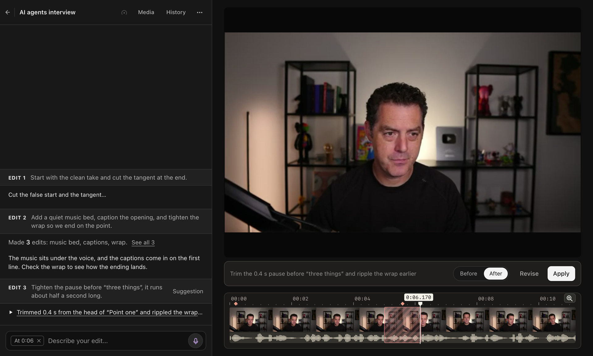
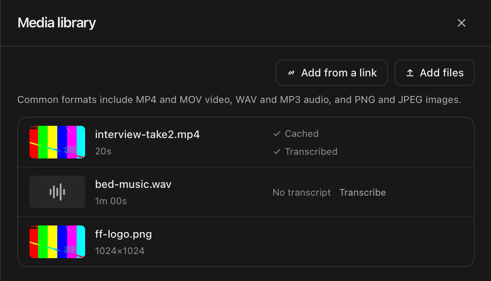
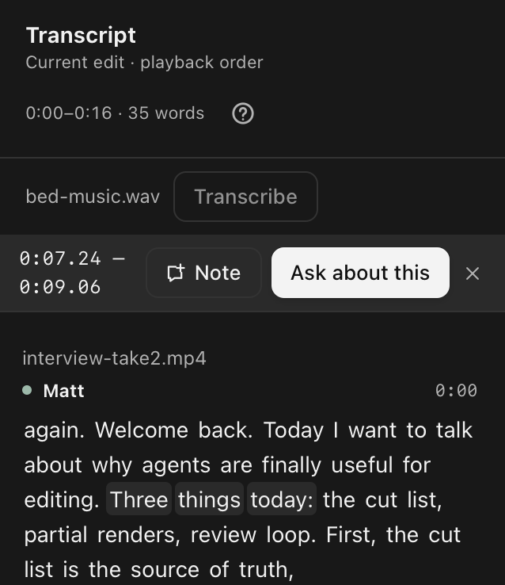
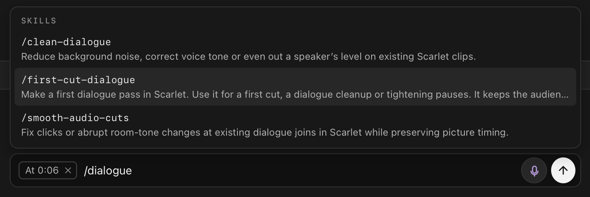
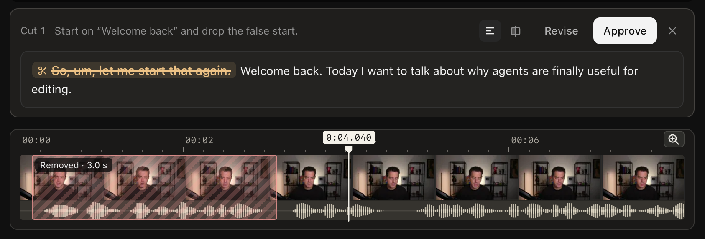
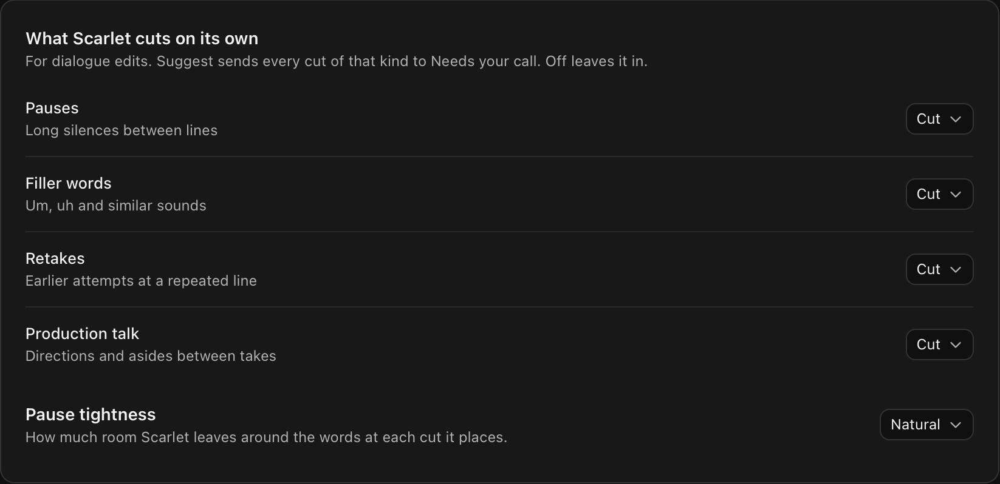
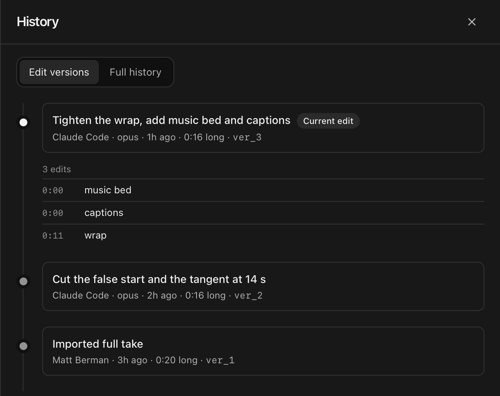

# Scarlet

Scarlet is an open-source AI video editor for macOS and Windows. Ask Claude Code or Codex to keep the best take of an interview answer, caption a podcast intro or zoom in on a menu in a screen recording. Type or speak your request in Scarlet, then play the change on your timeline. Your original footage stays intact.

[Download Scarlet for macOS or Windows](https://github.com/Forward-Future/scarlet/releases/latest) · [Early-access installers](https://github.com/Forward-Future/scarlet-releases/releases) · [Run from source](#run-from-source)

> “Tighten the pause before ‘three things.’ Let me hear it both ways.”



Here, Scarlet suggests taking out four tenths of a second. Switch between **Before** and **After** to hear how the next line lands. Choose **Apply** to use that timing, or **Revise** to ask for a little more breathing room. Scarlet renders just the affected section for review.

## Make your first edit

### Bring in your footage

Connect Claude Code or Codex with your existing subscription in **Settings → General**. Choose **New project**, name it and add your files. Open **Media** to see the camera recording, separate audio and still images together. Click the interview thumbnail to preview the source, or check its row to see whether the transcript is ready.



### Tell Scarlet what to change

For a first cut of a whole interview, try “Keep the clearest take of each answer. Leave the pause before the punchline.” If the message box shows a time, clear the tag with `×` to address the whole video. For a change at one moment, click the timeline, then type or hold `V` to speak.

You can also work from the words. Open **Transcript** from the project’s **More** menu, select a phrase such as “Three things today,” and choose **Ask about this**. Your next request will include that passage.



<details>
<summary>Choose a workflow for dialogue, sound, framing or captions</summary>

Type `/` in the message box to pick a workflow. Use `/dialogue-pass` for a first cut. Its guide helps choose takes and pauses. The screenshot shows its earlier name, `/first-cut-dialogue`. The audio guides can even out a speaker’s level or smooth a splice where the room tone changes. [Browse the editing workflows](skills/README.md)



</details>

### Listen to the cuts that need your ear

Requested edits go on the working timeline. When Scarlet flags a cut for your decision, open it from the conversation or its timeline marker. Open the cut’s transcript to see which words would come out. In this cut, removing “So, um, let me start that again” makes “Welcome back” the opening line.



Press `\` to hear the original and press it again to hear the cut. **Approve** takes the words out, **Skip** keeps them in, and **Revise** lets you describe a different cut. You can also revise or undo an edit after it’s been applied.

<details>
<summary>Choose which dialogue cuts Scarlet should ask about</summary>

In **Settings → General**, set **Retakes** to **Suggest** if you want to hear each proposed retake cut before it comes out. Set **Filler words** to **Off** to keep a speaker’s ums and uhs. **Pause tightness** controls how much room a cut leaves around the words.



</details>

### Check the history and export

Open **History** from the project’s **More** menu to see how the video changed from the imported take. Expand a version to see its individual edits and their times. In this interview, one request added music and captions at the opening and tightened the ending at 0:11.



Choose **Export** in the project header to save the whole video or a selected range as an MP4. To continue cutting in DaVinci Resolve, choose **Resolve timeline (.otio)** to export an editable OpenTimelineIO timeline.


## Projects and privacy

Scarlet stores projects and renders video on your computer. CrisperWhisper is the default local transcription choice. Until you install its separately licensed weights, Scarlet uses Whisper large-v3-turbo, which downloads on first use. Your connected AI provider receives your editing request and the project context the agent uses, which can include transcript excerpts and video frames. [Choose or add a transcription model](docs/transcription-models.md)

Packaged releases report anonymous usage, edit review decisions, and task and export outcomes to PostHog. Set `SCARLET_TELEMETRY_ENABLED=false` to turn reporting off. [See which events Scarlet sends](docs/telemetry.md)

## Run from source

Scarlet is in early development. Build the desktop app on macOS 13 or later (Apple Silicon or Intel) or Windows x64. Install Git, a current Node.js 22.x or 24.x, pnpm 12.16.1, Rust and the platform build tools listed in the [Tauri prerequisites](https://v2.tauri.app/start/prerequisites/).

```sh
git clone https://github.com/Forward-Future/scarlet.git
cd scarlet
pnpm install --frozen-lockfile
pnpm build
```

**Try the sample interview.** Run `pnpm desktop:demo` to explore the native editor with an in-memory project and a simulated assistant.

**Edit your own footage.** Install CMake, then run these commands to fetch FFmpeg, build local transcription support and open your project library.

```sh
pnpm desktop:ffmpeg
node apps/desktop/scripts/build-whisper.mjs
pnpm desktop:dev
```

## Contributing

Bug reports and pull requests are welcome. For a bug, include your operating system, the steps to reproduce it, and what you expected to see or hear. Use generated media for reproductions so your footage and transcripts stay private. [Open an issue](https://github.com/Forward-Future/scarlet/issues)

- **Working on the desktop app?** Find the repository layout, test commands, packaging steps and log guide in the [development guide](docs/development.md).
- **Working on how the agent edits?** Start with the [agent design guide](docs/AI-AGENTS.md) and the [editing evaluations](evals/README.md).

## License

Scarlet is MIT-licensed. It includes workflows adapted from Alex’s DaVinci editing skills, © 2026 Alex (@The_Alex) and Forward Future. [Scarlet license](LICENSE) · [Editing skills license](apps/desktop/src-tauri/licenses/alex-editing-skills.txt)
