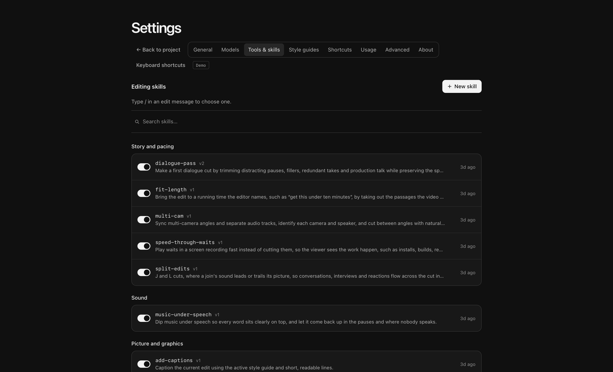
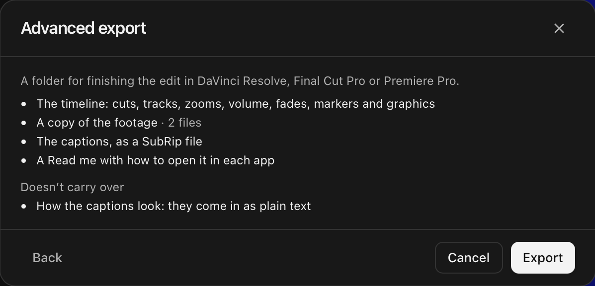

<p align="center">
  
</p>

<h1 align="center">Scarlet</h1>

<p align="center">
  <strong>Open-source AI video editor for macOS, Windows, and Linux.</strong><br>
  Tell Claude Code or Codex what to change—by voice, in writing, or by drawing on a frame—and hear the edit on your timeline in seconds. Your original footage stays untouched.
</p>

<p align="center">
  <a href="https://github.com/Forward-Future/scarlet-releases/releases"><strong>Download Early Access (macOS &amp; Windows)</strong></a>
  &nbsp;·&nbsp;
  <a href="https://github.com/Forward-Future/scarlet-releases/releases?q=Ubuntu">Ubuntu 24.04 x86-64 Preview</a>
  &nbsp;·&nbsp;
  <a href="https://github.com/Forward-Future/scarlet/releases">Stable Releases</a>
  &nbsp;·&nbsp;
  <a href="skills/README.md">Editing Workflows</a>
</p>

<p align="center">
  
</p>

---

Scarlet is built around a simple idea: **agents edit the cut list, Scarlet renders the video, and you make the creative calls.**

Instead of waiting for full re-renders or hunting through a timeline, Scarlet renders just the affected seconds so you can judge every cut in context. It shines on dialogue-heavy footage—interviews, talking-head videos, podcasts, and screen demos—while keeping every edit versioned and non-destructive.

> “Tighten the pause before ‘three things.’ Let me hear it both ways.”

---

## Major Features

### Edit by conversation, voice, or frame markup
- **Bring your own agent:** Connect **Claude Code** or **Codex** using your existing subscription in **Settings → General**. Scarlet runs your agent locally over MCP—no separate AI billing or terminal wrangling.
- **Voice or text, whole video or exact moment:** Type in the composer or hold `V` to talk. Ask for a whole-video pass, or target a specific spot by pausing (`Space`), scrubbing, dragging a range on the ruler (with a frame-accurate close-up loupe), or highlighting words in the transcript.
- **Draw directly on the frame (`M`):** Sketch, box, or point on the paused video frame so your agent sees exactly which part of the picture you mean. You can also drop reference images or PDF brand guides straight onto the message box.
- **Non-destructive version history:** Every edit saves a new timeline version. Step back through earlier cuts in **History**, or press `⌘Z` / `Ctrl+Z` to undo keeps, rejections, and revisions.

### Fast review, Before/After playback & live transcript

<p align="center">
  
</p>

- **Partial segment rendering:** Scarlet only re-renders the seconds around a change and stitches the rest from cached segments, so playback stays fast even on long recordings.
- **Instant Before/After (`\`):** Open any edit or cut card above the timeline and press `\` to flip between the removed footage and the new join. Click the transcript icon on a cut card to inspect struck-through removed words alongside the surrounding sentence.
- **Focused `For you` review queue:** Confident edits go straight onto your working timeline; judgment calls and flagged edits wait in **For you**. Step through them with `↑` / `↓` and press `K` (Keep), `A` (Approve), `S` (Skip), `R` (Revise), or `×` (Reject).
- **Searchable Transcript rail:** Open **Transcript** from the `⋯` menu to read along beside the player, search spoken phrases, click any word to jump the playhead, or select a passage to ask about.
- **Parallel edit revisions:** Ask for revisions on several different cuts or edits at the same time—Scarlet runs an agent on each while safely queuing whole-video requests above the message box.

### Built-in editing workflows (Skills) & Learnings

<p align="center">
  
</p>

Type `/` in the composer to run one of Scarlet’s built-in editing workflows. Every workflow is an editable Markdown guide shared across your projects—customize them in **Settings → Tools & skills**, compose your own style on top of shipped guides, or turn an approved edit into a reusable skill.

| Workflow | What it does |
| --- | --- |
| `/dialogue-pass` | Cuts false starts, redundant takes, filler words, and dead air while preserving natural pacing and flagging judgment calls. |
| `/frame-screen` | Zooms smoothly onto the active pane or spoken text in screen recordings while keeping camera insets clear of on-screen text. |
| `/punch-in` | Cuts between wide and tight framing across talking-head jump cuts and key lines using local face tracking. |
| `/add-captions` | Builds clean, readable caption tracks timed to retained speech. |
| `/motion-graphics` | Generates lower thirds, titles, and callouts from HTML/CSS/JS rendered locally to transparent ProRes 4444 via bundled headless Chrome. |
| `/b-roll` | Plans B-roll and graphic spots as To-dos first, then sources or creates only the ones you ask for. |
| `/speed-through-waits` | Speeds through installs, builds, and loading screens while keeping tracks in sync and speech at normal speed. |
| `/fit-length` | Trims an edit down to a target runtime by removing the least essential passages first. |
| `/tighten-pauses-here` | Focuses pause tightening on a selected passage or the region around the playhead. |

**Learnings:** When a request sounds like a recurring preference (for example, *“Keep laughs in—only cut dead air after them”*), Scarlet surfaces it as a suggested rule. Approve it to update your skill automatically, edit the wording in place, or dismiss it. [Browse all workflows →](skills/README.md)

### Local media perception & cut safety
So your agent edits from real measurements instead of guesswork, Scarlet analyzes footage locally on your machine:
- **Verbatim transcription & tight word alignment:** Uses **CrisperWhisper 2.0 large** by default when installed (or bundled **Whisper large-v3-turbo** out of the box), refined with local wav2vec2 CTC forced alignment and acoustic filler detection. Also supports custom local models and OpenAI Whisper (cloud).
- **Audio & join safety:** 16 kHz waveform and room-tone analysis, multi-input voice awareness, optional audio crossfades, and safety gates that keep cut edges out of spoken words.
- **Visual intelligence:** Local OCR reads text on screen recordings and lines it up with what the speaker reads aloud; local face tracking follows faces and gaze direction for punch-ins and vertical reframing; screen-motion and recording-cut detection keep screen inserts clean.

### Export & NLE handoff

<p align="center">
  
</p>

- **Direct MP4 export:** Export the full cut or a custom time range in **Compressed**, **High** (hardware-accelerated), or **Original quality**.
- **Caption files:** Export the captions alone as SubRip (`.srt`) or WebVTT (`.vtt`), for the whole video or a custom range.
- **Finish in your NLE (`Advanced export`):** Save a self-contained handoff folder with `.fcpxml` (DaVinci Resolve, Final Cut Pro), `.otio` (Premiere Pro 26.5+, DaVinci Resolve), copies of the used footage, `.srt` captions, and a plain-English Read me explaining how to open it in each app and what does not carry over.
- **Native desktop app & open MCP engine:** Built with Tauri 2 (Rust shell + local SQLite/Node engine + FFmpeg + headless Chrome) for macOS (Apple Silicon & Intel), Windows x64, and Ubuntu 24.04 x86-64. Power users can also connect external MCP clients (`pnpm mcp`) or run the headless engine via Docker (`docker compose up -d`).

---

## Make Your First Edit

1. **Import your footage.** Click **New project**, name it, and choose your files—mix video (MP4, MOV), separate audio (WAV, MP3), and images (PNG, JPEG). You can start editing while proxies and transcripts prepare. In **Settings → General**, connect **Claude Code** or **Codex**.
2. **Ask for a change.** Click a point on the timeline (or clear the time tag with `×` to edit the whole video), then type or hold `V` to speak. Try *“Remove the false starts and repeated takes, and keep the pauses before each answer”*—or type `/dialogue-pass` for a full first cut.
3. **Review in context.** Open any edit from the conversation or timeline. Toggle Before/After with `\`, expand the cut’s transcript to see removed words, and step through items in **For you** with `↑` / `↓` to **Keep (`K`)**, **Approve (`A`)**, **Skip (`S`)**, or **Revise (`R`)**.
4. **Export or hand off.** Click **Export** in the project header to save an MP4 or its captions as `.srt` or `.vtt`, or choose **Advanced export** to create a handoff folder for DaVinci Resolve, Final Cut Pro, or Premiere Pro.

### Everyday Shortcuts

| Key | Action |
| --- | --- |
| `V` (hold) | Talk to Scarlet by voice |
| `Space` | Play / pause (pausing aims the empty composer at that frame) |
| `\` | Toggle Before / After on the open edit or cut |
| `↑` / `↓` | Step to previous / next edit or review call |
| `←` / `→` | Skip 5 seconds (`Shift` for 1 second) |
| `K` / `A` / `S` / `R` | Keep edit · Approve call · Skip call · Revise |
| `M` | Mark up the current frame (`D` draw, `B` box, `P` point) |
| `/` | Pick an editing workflow in the composer |
| `−` / `+` / `0` | Zoom timeline out / in / fit |
| `⌘Z` / `Ctrl+Z` | Undo last Keep, Reject, or revision |
| `?` | Show all keyboard shortcuts |

---

## Run From Source

Scarlet is in active early development. You can build the native desktop app on **macOS 13+** (Apple Silicon or Intel), **Windows x64**, or **Ubuntu 24.04 x86-64**.

**Prerequisites:** Git, Node.js 22.x or 24.x, pnpm 12.16.1, Rust, and the platform build tools in the [Tauri prerequisites](https://v2.tauri.app/start/prerequisites/). On Ubuntu, install the [desktop build and playback dependencies](docs/development.md#ubuntu-2404-x86-64) first.

```sh
git clone https://github.com/Forward-Future/scarlet.git
cd scarlet
pnpm install --frozen-lockfile
pnpm build
```

**Try the sample interview (no setup required):**
```sh
pnpm desktop:demo
```
Opens the native editor with an isolated in-memory project and simulated assistant.

**Edit your own footage:**
Install CMake, then fetch the pinned media tools, build local Whisper support, and launch the desktop app:

```sh
pnpm desktop:ffmpeg
pnpm desktop:chrome
node apps/desktop/scripts/build-whisper.mjs
pnpm desktop:dev
```

---

## Privacy, Local Models & Telemetry

- **Local by default:** Scarlet stores your projects, transcripts, waveforms, and renders on your computer.
- **Transcription models:** **CrisperWhisper 2.0 large** is the default local choice once its separately licensed weights are installed. Until then, Scarlet uses bundled **Whisper large-v3-turbo** (downloaded on first use). You can also configure a custom local model or OpenAI Whisper in **Settings → General**. [Transcription model guide →](docs/transcription-models.md)
- **AI provider data:** Your connected AI provider receives your editing request and the project context the agent inspects (such as transcript excerpts and video frames).
- **Optional telemetry:** Packaged releases send anonymous usage, edit review decisions, and task/export outcomes to PostHog. Turn off **Send usage reports** in **Settings → About**, or set `SCARLET_TELEMETRY_ENABLED=false` before launching Scarlet (Early Access versions through 0.1.3 use the environment variable). [See which events Scarlet sends →](docs/telemetry.md)

---

## Contributing

Bug reports and pull requests are welcome! When filing a bug, please include your operating system, steps to reproduce, and what you expected to see or hear—and use generated media so your own footage and transcripts stay private.

- [Open an issue](https://github.com/Forward-Future/scarlet/issues) · [Contributing guide](CONTRIBUTING.md) · [Code of conduct](CODE_OF_CONDUCT.md)
- **Working on the desktop app or engine?** Start with the [Development guide](docs/development.md).
- **Working on how agents edit?** Read [How Scarlet works with AI agents](docs/AI-AGENTS.md) and the [Editing evaluations](evals/README.md).

## License

Scarlet is [MIT-licensed](LICENSE). It includes workflows adapted from Alex’s DaVinci editing skills, © 2026 Alex (@The_Alex) and Forward Future ([license](apps/desktop/src-tauri/licenses/alex-editing-skills.txt)). Acoustic filler detection is [Powered by Desert Ant Labs](https://desertant.com/).
