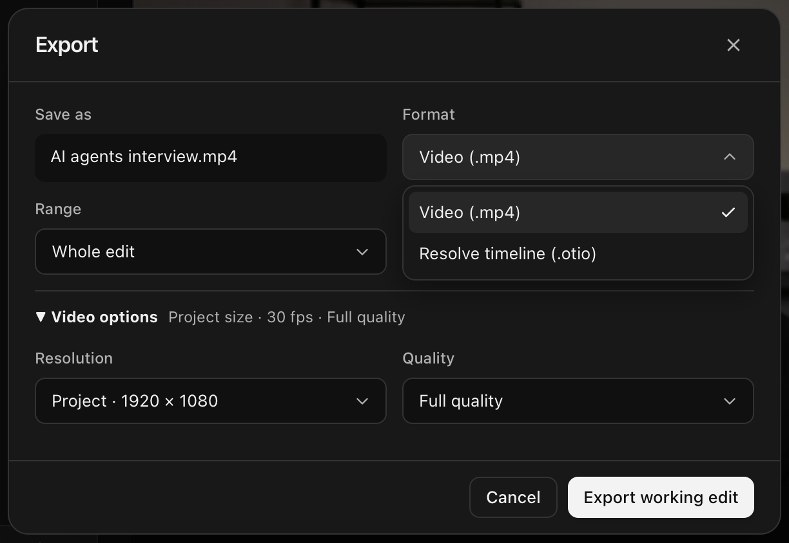

# Scarlet

Scarlet is an open-source AI video editor for macOS and Windows. Tell Claude Code or Codex what you want to change, by voice or in writing, then play the edit on your timeline. Your original footage stays intact.

Scarlet works especially well on dialogue-heavy recordings. Start with an interview, a video podcast or a talking-head take. Ask it to shorten long pauses, remove a repeated phrase or keep the clearest take of an answer. Tell it where the timing matters to you, such as a pause before a punchline.

> “Tighten the pause before ‘three things.’ Let me hear it both ways.”

Scarlet renders just the affected section so you can hear what a change sounds like in context. Requested edits go on the working timeline. Suggestions wait for you to apply them. For a first cut of a whole interview, you can jump straight to the cuts the agent flags for a second listen.

[Download Scarlet for macOS or Windows](https://github.com/Forward-Future/scarlet/releases/latest)

## Run from source

Scarlet is in early development. Build the desktop app on macOS 13 or later (Apple Silicon or Intel) or Windows x64. Install Git, a current Node.js 22.x or 24.x, pnpm 12.16.1, Rust and the platform build tools listed in the [Tauri prerequisites](https://v2.tauri.app/start/prerequisites/).

```sh
git clone https://github.com/Forward-Future/scarlet.git
cd scarlet
pnpm install --frozen-lockfile
pnpm build
```

**Try the sample interview.** Run `pnpm desktop:demo` to explore the native editor with an in-memory project and a simulated assistant.

**Edit your own footage.** Install CMake, then run these commands to fetch FFmpeg, build local transcription support and open your project library.

```sh
pnpm desktop:ffmpeg
node apps/desktop/scripts/build-whisper.mjs
pnpm desktop:dev
```

## Make your first edit

1. **Bring in your footage.** Click **New project**, name it and choose your files. You can mix video (such as MP4 or MOV), separate audio (WAV or MP3) and still images (PNG or JPEG). The project opens to the media library, where you can see import progress and preview a clip. Click **Media** in the project header to return to your files or add more. In **Settings → General**, connect Claude Code or Codex with your existing subscription.

2. **Ask for a change.** Click a point on the timeline, then type or hold `V` to speak. To work on the whole interview, clear the time tag with `×` and try “Remove the false starts and repeated takes. Keep the pauses before each answer.” Type `/dialogue-pass` for a first dialogue cut, or type `/` to choose another workflow. To change how Scarlet handles dialogue across projects, edit **dialogue-pass** in **Settings → Tools & skills**. [Browse the workflows](skills/README.md)

3. **Review it in context.** Open an edit from the conversation or timeline. On a cut, open the transcript to see the words Scarlet marked for removal. Press `\` to hear the removed footage and press it again to hear the join. When a dialogue pass asks about a cut, approve it, skip it or ask for a revision. You can also revise or undo an applied edit. Earlier versions stay in the project history.

4. **Export the cut.** Click **Export** in the project header to save the whole video or a selected range as an MP4. To keep editing in DaVinci Resolve, export the timeline as an OpenTimelineIO (`.otio`) file.

   

Scarlet stores projects and renders video on your computer. CrisperWhisper is the default local transcription choice. Until you install its separately licensed weights, Scarlet uses Whisper large-v3-turbo, which downloads on first use. Your connected AI provider receives your editing request and the project context the agent uses, which can include transcript excerpts and video frames. [Choose or add a transcription model](docs/transcription-models.md)

Packaged releases report anonymous usage, edit review decisions, and task and export outcomes to PostHog. Set `SCARLET_TELEMETRY_ENABLED=false` to turn reporting off. [See which events Scarlet sends](docs/telemetry.md)

## Contributing

Bug reports and pull requests are welcome. For a bug, include your operating system, the steps to reproduce it, and what you expected to see or hear. Use generated media for reproductions so your footage and transcripts stay private. [Open an issue](https://github.com/Forward-Future/scarlet/issues)

- **Working on the desktop app?** Find the repository layout, test commands, packaging steps and log guide in the [development guide](docs/development.md).
- **Working on how the agent edits?** Start with the [agent design guide](docs/AI-AGENTS.md) and the [editing evaluations](evals/README.md).

## License

Scarlet is MIT-licensed. It includes workflows adapted from Alex’s DaVinci editing skills, © 2026 Alex (@The_Alex) and Forward Future. [Scarlet license](LICENSE) · [Editing skills license](apps/desktop/src-tauri/licenses/alex-editing-skills.txt)
